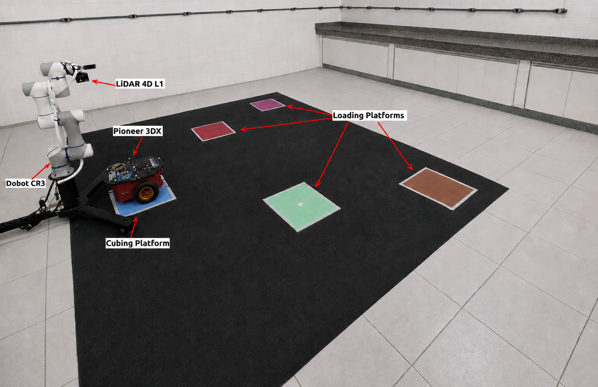
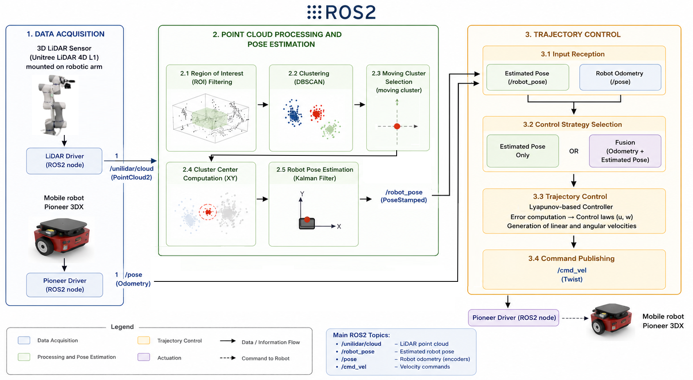

# findRobot
 Still under construction...

# LiDAR-Based Box Dimensioning in a Multi-Robot Logistics Scenario

This project implements a distributed robotic system for locating and controlling a mobile robot based on the position estimated from the point cloud obtained by the static 3D LiDAR sensor and the orientation of the mobile robot was through the ROS2 node of the Pioneer 3Dx robot.

-**Image of Experimental Enviroment**



-**Image of the System Architecture**



---

## 🏗 System Architecture

The system is distributed across four processing units to balance the computational load:

| Hardware                 | OS           | ROS 2   | Responsibility                          |
|--------------------------|--------------|---------|-----------------------------------------|              
| PC 1 (Vision processing) | Ubuntu 22.04 | Humble  | LiDAR PointCloud Processing (Open3D)    |
| Raspberry Pi 5           | Ubuntu 22.04 | Humble  | Pioneer P3-DX Driver and Control nodes  |
| Raspberry Pi 5           | Ubuntu 20.04 | Foxy    | Unitree LiDAR Driver SDK                |

---

## 🛠 Prerequisites & Installation

1. **Vision & Processing (PC 1)**
   - Install [Ubuntu 22.04](https://releases.ubuntu.com/jammy/)
   - Install [ROS2 Humble](https://docs.ros.org/en/humble/Installation.html)
   - Download the findRobotPoseEstimation_v9_Cilinder.py from this repository
   - Install Open3D: `pip3 install open3d`.

2. **Mobile Robot Control trajectory (PC 1)**
   - Install [Ubuntu 22.04](https://releases.ubuntu.com/jammy/)
   - Install [ROS2 Humble](https://docs.ros.org/en/humble/Installation.html)
   - Download the pioneerController_ROS2_Trajectory_FilterLidar3D_v2.py from this repository
  
3. **Mobile Base (Raspberry PI 5)**
    - Raspberry Pi OS 64 [https://www.raspberrypi.com/software/]
    - Install docker [https://raspberry.tips/en/raspberrypi-tutorials/install-docker-raspberry-pi]
    - In the docker:
      - Install [Ubuntu 22.04](https://releases.ubuntu.com/jammy/)
      - Install [ROS2 Humble](https://docs.ros.org/en/humble/Installation.html)
      - Install RosAria Driver [adapted for ROS 2](https://github.com/Bessawy/RosAria2)
      - Connect via Serial-to-USB to the Pioneer.

6. **LiDAR Sensor Driver node(Raspberry Pi 5)**
   - Raspberry Pi OS 64 [https://www.raspberrypi.com/software/]
   - Install docker [https://raspberry.tips/en/raspberrypi-tutorials/install-docker-raspberry-pi]
   - In the docker:
     - Install [Ubuntu 20.04](https://github.com/Joshua-Riek/ubuntu-raspberry-pi) or install Ubuntu 22.04 and Docker with         Ubuntu 20.04.
     - Install [ROS2 Foxy](https://docs.ros.org/en/foxy/Installation.html)
     - Install Unitree [LiDAR SDK ROS2](https://github.com/unitreerobotics/unilidar_sdk/blob/main/unitree_lidar_ros2/src/unitree_lidar_ros2/README.md)
---

## 🚀 Execution Sequence

To ensure the handshakes between nodes occur correctly, follow this specific launch order.  
**Note:** Every terminal must have the ROS 2 environment sourced (`source /opt/ros/<distro>/setup.bash`) and export ROS_DOMAIN_ID=0. Make sure that all devices are on the same network. Before running the tests, set up the parameters for each of the codes to be executed according to your environment. First, run the driver node for the 4D L1 LiDAR sensor on the Raspberry Pi 5 connected to it via USB, as well as the driver node for the Pioneer 3DX robot on the other Raspberry Pi 5 connected to it via USB. Then, run the point cloud processing node on the PC. When the point cloud is displayed, run the navigation control node for the Pioneer 3DX on the Raspberry Pi 5 connected to it.. For more information, read the article to which this repository is linked.

  ### Step 1: Lidar Driver Nodes (Raspberry Pi 5 - SSH)
  - Connect via SSH and start the relay node at a terminal:
    
    cd unilidar_sdk/unitree_lidar_ros2/
    source install/setup.bash
    ros2 launch unitree_lidar_ros2 launch.py
    ```

 ### Step 2: Pioneer Node Driver (Raspberry PI 5 - SSH)
   - Connect via SSH and Start the mobile driver node:
    ```
    source ~/pioneer/foxy/local_setup.bash
    ros2 run rosaria RosAria
    ```
  
  ### Step 3: LiDAR Processing Node (PC 1)
  - Run the position estimation script:
    ```
    python3 findRobotPoseEstimation_v9_Cilinder.py.py
    ```

   ### Step 4: Pioneer 3DX Controller Node (Raspberry PI 5 - SSH)
   - Connect via SSH and Start the mobile driver node:
     ```
     python3 pioneerController_ROS2_Trajectory_FilterLidar3D_v2.py
     ```

---
## 🔄 Communication Flow (The "Handshake")

- The driver node for the 4D LiDAR sensor captures the point cloud of the environment and publishes it on its ROS2 topic.
- The Pioneer 3DX driver node publishes the robot's pose on its ROS2 topic.
- The point cloud processing node estimates the position of the mobile robot and publishes it on its ROS2 topic.
- Finally, the mobile robot's control and navigation node receives the position estimated by the point cloud processing node, along with the odometry pose from the Pioneer 3DX driver node. Based on the configuration, it controls the robot's navigation along the predefined trajectory, according to the previously selected method, either LiDAR only or Fusion.  

---

## 📝 Authors

- **Luciano Gonçalves Moreira** - luciano.goncalves@ufv.br (UFV / IF Sudeste MG)  
- **Alexandre Santos Brandão** - Alexandre.brandao@ufv.br (UFV)

